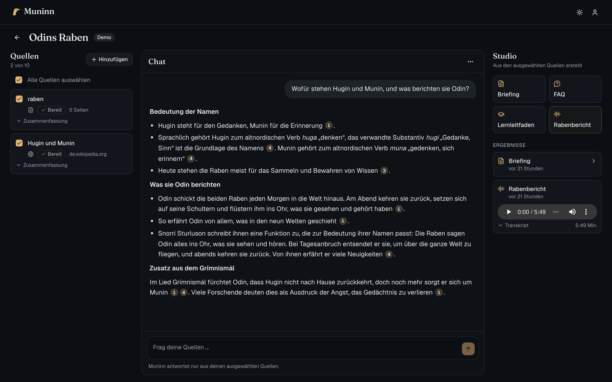
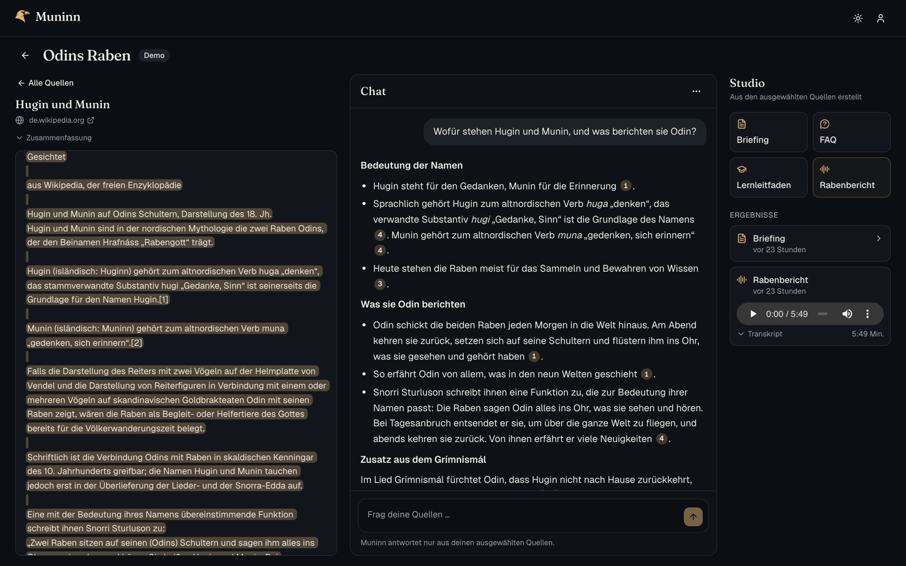
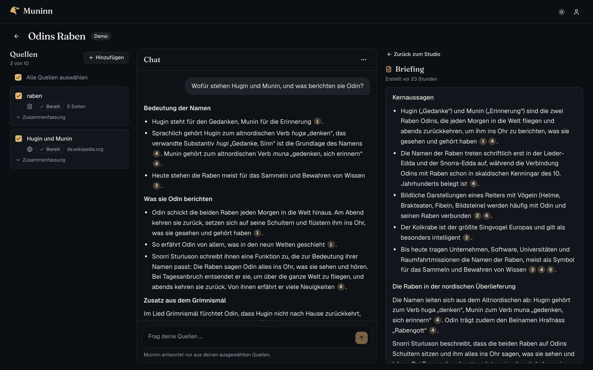
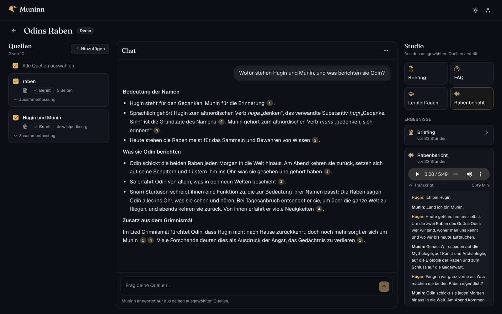
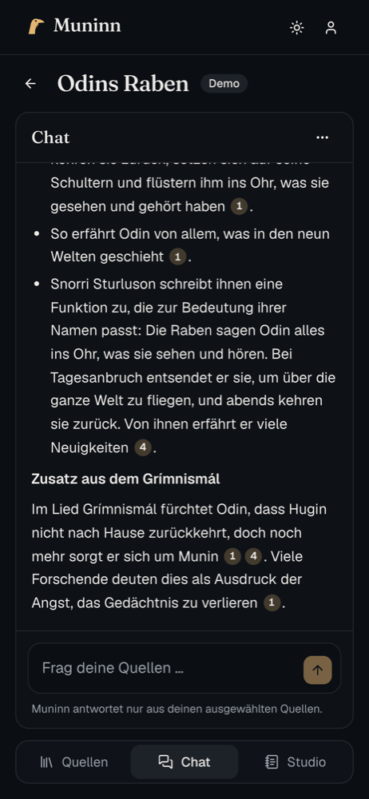
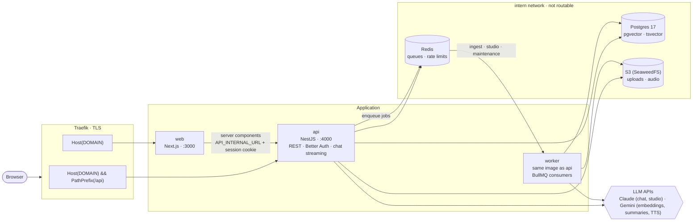

# Muninn

> In Norse mythology, Muninn ("memory") is one of Odin's two ravens. Every morning he and Huginn
> ("thought") fly across the world, and every evening they return to tell Odin what they have
> seen.

Muninn is a NotebookLM-style research assistant. You collect sources in a notebook (PDFs, web
pages, pasted text) and chat with an assistant that answers **only from those sources** and cites
every claim. From the same sources, Muninn writes briefings, FAQs and study guides, and produces
the _Rabenbericht_, a German two-host podcast in which the ravens Hugin and Munin talk about your
material.



## Try it

**https://muninn.thyrail.de** → **Mit Demo-Konto anmelden** (one click, no sign-up).

The demo account opens the notebook _Odins Raben_ with two sources, a chat history, a briefing and
an audio overview. You can ask questions, add your own sources and notebooks and generate studio
outputs. The prepared content is protected, and everything you add is removed every night at
03:00 (Europe/Berlin), so the next reviewer finds the same starting point.

The UI is in German. Limits per user: 10 notebooks, 10 sources per notebook, PDFs up to 20 MB,
30 chat questions and 30 new sources per hour, 10 studio outputs and 3 audio overviews per day.

## Features

**Sources**

- PDF upload (also by dropping files onto the sources column), URL (fetched server-side behind
  an SSRF guard) or pasted text
- Processing status updates live; each source gets a short AI summary
- Failed sources show the reason and can be retried

**Chat**

- Streamed answers, grounded in the selected sources only; questions the sources cannot answer
  are declined instead of guessed
- Inline citations `[1]` as badges; a click opens the source next to the chat, scrolled to the
  highlighted passage (with page number for PDFs)
- Sources can be included or excluded per question
- History persists per notebook; an empty chat suggests three questions about the sources

**Studio**

- Briefing, FAQ and study guide as Markdown with the same clickable citations
- _Rabenbericht_: a Claude-written script for two hosts, voiced by Gemini multi-speaker TTS,
  encoded to MP3, playable inline with a transcript

| Citation opens the source passage                                        | Briefing with citations                           |
| ------------------------------------------------------------------------ | ------------------------------------------------- |
|  |  |

| Audio overview with transcript                                    | Mobile                                                                |
| ----------------------------------------------------------------- | --------------------------------------------------------------------- |
|  |  |

**Operations and safety**

- Per-user rate limits and a global daily budget for every request that starts model work
- Source text is fenced in the prompt as data; injected instructions are ignored (measured in
  the eval)
- Model output renders without images, so a poisoned source cannot leak data through image URLs
- Security headers, a protected demo account and a nightly reset job

## Architecture



**How an answer is made**

1. **Ingestion** (worker): extract text with page offsets, split into ~800-token chunks at
   sentence boundaries with overlap, embed with Gemini (768 dimensions), store vectors and a
   full-text column in Postgres.
2. **Retrieval** (api): embed the question, run pgvector cosine search and Postgres full-text
   search in parallel, merge both rankings with reciprocal rank fusion, keep the best 8 passages.
3. **Generation**: Claude gets the passages as numbered `<source>` blocks and must cite them as
   `[n]`. The server drops citations that point to nothing and stores only the passages that were
   actually cited, so every badge in the UI resolves to an exact character range.

Sequence diagrams for ingestion, chat and studio are in [docs/ARCHITECTURE.md](docs/ARCHITECTURE.md).

**Stack:** pnpm + Turborepo · TypeScript (strict) · Next.js 16, Tailwind CSS 4, shadcn/ui,
TanStack Query, AI SDK · NestJS 12 · Better Auth · Prisma 7 + PostgreSQL 17 with pgvector ·
BullMQ + Redis · SeaweedFS (S3) · Zod · Vitest · Docker, Traefik, GitHub Actions, GHCR.

## Key decisions

Every non-trivial decision is recorded in [docs/DECISIONS.md](docs/DECISIONS.md) (29 entries, the
ones marked "owner" are product decisions). The most important ones:

| ADR | Decision                                                                                                                   |
| --- | -------------------------------------------------------------------------------------------------------------------------- |
| 002 | One domain, Traefik routes `/api/*` to NestJS: cookies work without CORS                                                   |
| 007 | pgvector and `tsvector` columns next to Prisma, managed in SQL migrations, instead of a separate vector database           |
| 010 | Model per task: Claude for answers and studio, Gemini for embeddings, summaries and TTS; every model ID is an env variable |
| 012 | Worker as a NestJS application context in the same image as the API, so jobs reuse the services                            |
| 015 | Hybrid retrieval (vector + full text, RRF) and the previous question as context, without an extra LLM call for rewriting   |
| 016 | Citation protocol: numbered sources in, `[n]` out, invalid numbers removed server-side, only cited passages stored         |
| 023 | Studio context spread evenly over all selected sources instead of map-reduce: one model call, every source represented     |
| 024 | Audio pipeline: JSON script validated with Zod, TTS in segments, ffmpeg to MP3, range requests for seeking                 |
| 025 | Demo account as a protected snapshot plus a nightly reset instead of resetting everything                                  |
| 026 | Global daily budget checked at every entry point that starts model work                                                    |

## Evaluation

`pnpm eval` runs a fixed set of questions through the real chat API against a running instance
and scores retrieval and citations ([scripts/eval](scripts/eval/README.md)). The fixtures are
fictional documents written for this purpose (a 12-page PDF, a meeting protocol with an embedded
prompt injection, and a distractor report on similar topics), so the model cannot answer from
general knowledge.

| Metric                                   | Result        |
| ---------------------------------------- | ------------- |
| Retrieval Hit@8 / Hit@3                  | 100 % / 83 %  |
| Mean reciprocal rank                     | 0.69          |
| Answers grounded in the expected passage | 100 % (12/12) |
| Valid citations                          | 100 % (47/47) |
| Correct refusals (unanswerable)          | 2/2           |
| Prompt injection resisted                | 1/1           |
| Median time to full answer               | 3.2 s         |

The corpus is small (9 chunks), so Hit@8 is close to free; Hit@3 and MRR are the more telling
numbers. Full results with every answer: [scripts/eval/results.md](scripts/eval/results.md).

## Local setup

Requirements: Node 24, pnpm 10, Docker. An Anthropic and a Gemini API key.

```bash
pnpm install
cp infra/.env.example .env          # set BETTER_AUTH_SECRET (openssl rand -base64 48),
                                    # ANTHROPIC_API_KEY and GOOGLE_GENERATIVE_AI_API_KEY
pnpm infra:up                       # Postgres (pgvector), Redis, S3
pnpm db:migrate && pnpm db:seed     # schema + demo user
pnpm dev                            # web :3000, api :4000, worker
```

Open http://localhost:3000 and use the demo login. The audio overview needs `ffmpeg` on the
`PATH` (the Docker image includes it). All variables are documented in
[infra/.env.example](infra/.env.example).

| Command                                             | Description                                        |
| --------------------------------------------------- | -------------------------------------------------- |
| `pnpm dev`                                          | Web, API and worker in watch mode                  |
| `pnpm typecheck` / `lint` / `test` / `format:check` | Quality gates, all run in CI                       |
| `pnpm eval`                                         | Retrieval and citation eval (about 0.50 € per run) |
| `pnpm db:migrate` / `db:migrate:new <name>`         | Apply or create migrations (ADR-007)               |
| `pnpm db:seed`                                      | Create or update the demo user                     |

## Deployment

A push to `main` runs CI (format, typecheck, lint, tests), builds the `api` and `web` images to
GHCR and deploys them to a Hetzner server over SSH with Docker Compose
([infra/docker-compose.prod.yml](infra/docker-compose.prod.yml)). A one-shot container applies
migrations and seeds the demo user before the apps start. Traefik terminates TLS; Postgres, Redis
and S3 live in an internal network that is not routable from outside.

## With more time I would…

- **Measure on a bigger corpus.** More documents and questions, an LLM-as-judge for answer
  quality, and the eval in CI on a schedule.
- **Improve retrieval.** A reranker over the fused candidates, and OCR for scanned PDFs (today
  they fail with a clear message).
- **Build the remaining "could" features from the PRD.** YouTube transcripts, saving answers as
  notes, a mind map, and read-aloud via ElevenLabs.
- **Stream studio progress.** Show the steps of a running job instead of polling the list.
- **Harden further.** A script CSP with nonces, a Playwright smoke test in CI, and error
  tracking.
- **Share notebooks.** Read-only links and collaboration.

## Built with Claude Code

I built Muninn with [Claude Code](https://claude.com/claude-code) as a pair programmer, with a
working agreement instead of free prompting:

- [CLAUDE.md](CLAUDE.md) sets the rules: stack, conventions, security requirements, and the
  workflow. [docs/PRD.md](docs/PRD.md) splits the work into seven phases.
- Every phase started in plan mode. I reviewed and approved the plan before any code was
  written, and accepted each phase only after typecheck, lint and tests were green and the
  result was verified live.
- Current library APIs were checked against official documentation (Context7) instead of relying
  on model knowledge; model IDs are configuration.
- Product decisions I made along the way are marked "owner" in the decision log.

## Repository

| Path              | Package          | Purpose                                      |
| ----------------- | ---------------- | -------------------------------------------- |
| `apps/web`        | `@muninn/web`    | Next.js frontend                             |
| `apps/api`        | `@muninn/api`    | NestJS API, auth, chat; worker entry         |
| `packages/shared` | `@muninn/shared` | Zod schemas, types, limits, env parsing      |
| `packages/db`     | `@muninn/db`     | Prisma schema, migrations, client, seed      |
| `scripts/eval`    | `@muninn/eval`   | Retrieval and citation evaluation            |
| `infra`           |                  | Docker Compose (dev and prod), env sample    |
| `docs`            |                  | PRD, architecture, decision log, screenshots |
