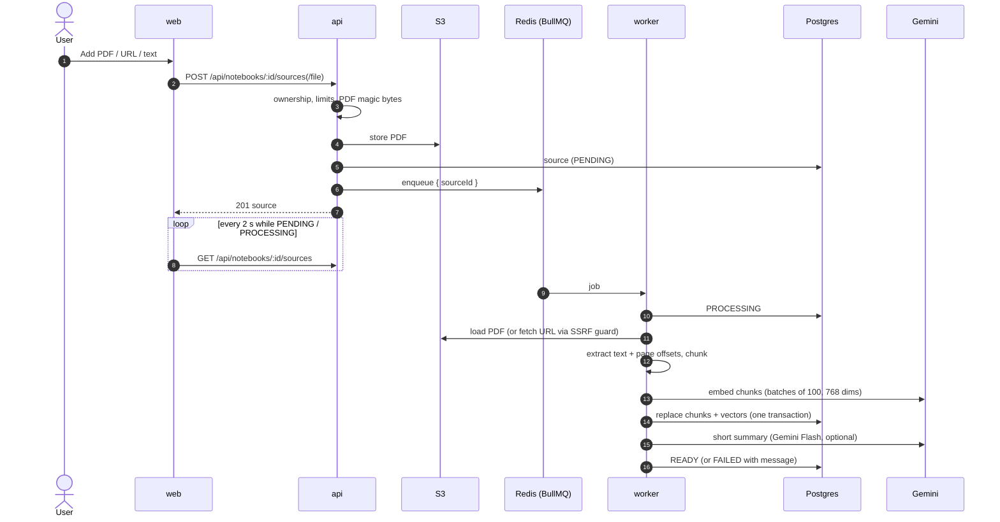
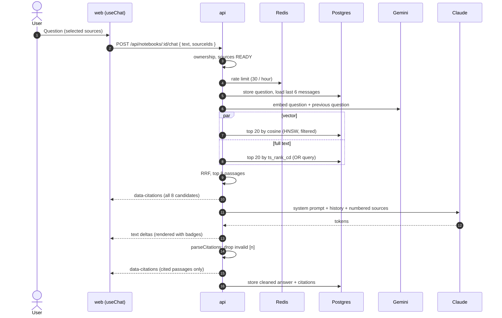

# Architecture

Muninn is a NotebookLM-style app: users upload sources into notebooks and chat with an assistant
that answers only from those sources, citing every claim.

## Ingestion

## Chat

## Workspace

The notebook page has three columns (sources, chat, studio) from `lg`, and tabs below. All
panels stay mounted, so switching tabs never interrupts a streaming answer (ADR-020).

Clicking a citation badge opens its source in the left column instead of the source list:
`GET /api/sources/:id` returns the extracted text with page offsets. The cited passage is
`text.slice(charStart, charEnd)`, because the chunker keeps exact offsets. The viewer splits
the text into pages, marks the passage and scrolls it into view.

The empty chat shows three suggested questions from `GET /api/notebooks/:id/suggestions`. They
are generated lazily and cached per set of READY sources (ADR-021).

## Key points

- **Same origin.** Traefik routes `/api/*` to NestJS and everything else to Next.js, so cookies
  work without CORS (ADR-002). Locally, Next.js rewrites `/api/*` to `localhost:4000`.
- **One image, two roles.** The API image also runs the worker (`node dist/worker.js`) and the
  one-shot migration job, which applies Prisma migrations and seeds the demo user before the apps
  start.
- **Network isolation.** Postgres, Redis and S3 live in an internal Docker network. Only `web`
  and `api` join the Traefik network; the worker gets a separate egress network for LLM calls.
- **Shared contracts.** `@muninn/shared` holds Zod schemas, limits and env validation used by
  both apps; `@muninn/db` holds the Prisma schema, migrations and client.
- **Retrieval.** Hybrid search: pgvector cosine (HNSW) plus Postgres full-text (OR query of the
  meaningful words), merged with reciprocal rank fusion (ADR-015). Citations follow ADR-016.

See [DECISIONS.md](DECISIONS.md) for the reasoning behind each choice.
