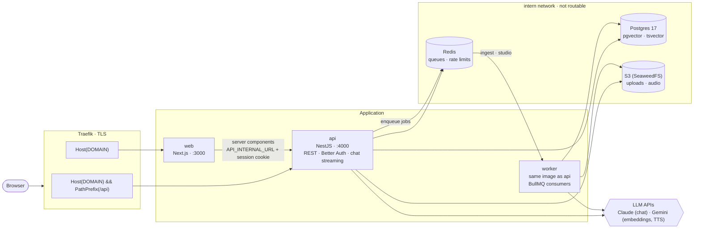

# Architecture

Muninn is a NotebookLM-style app: users upload sources into notebooks and chat with an assistant
that answers only from those sources, citing every claim.

## Key points

- **Same origin.** Traefik routes `/api/*` to NestJS and everything else to Next.js, so cookies
  work without CORS (ADR-002). Locally, Next.js rewrites `/api/*` to `localhost:4000`.
- **One image, two roles.** The API image also runs the worker (`node dist/worker.js`) and the
  one-shot migration job, which applies Prisma migrations and seeds the demo user before the apps
  start.
- **Network isolation.** Postgres, Redis and S3 live in an internal Docker network. Only `web`
  and `api` join the Traefik network; the worker gets a separate egress network for LLM calls.
- **Shared contracts.** `@muninn/shared` holds Zod schemas, limits and env validation used by
  both apps; `@muninn/db` holds the Prisma schema, migrations and client.
- **Retrieval (phase 3).** Hybrid search: pgvector cosine (HNSW) plus Postgres full-text
  (`websearch_to_tsquery`), merged with reciprocal rank fusion.

See [DECISIONS.md](DECISIONS.md) for the reasoning behind each choice.
